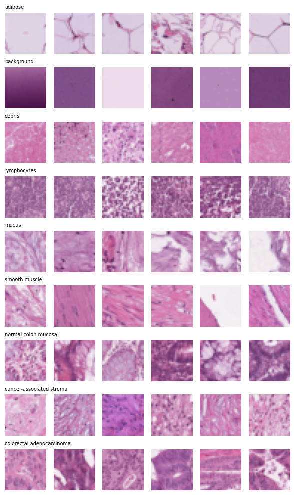
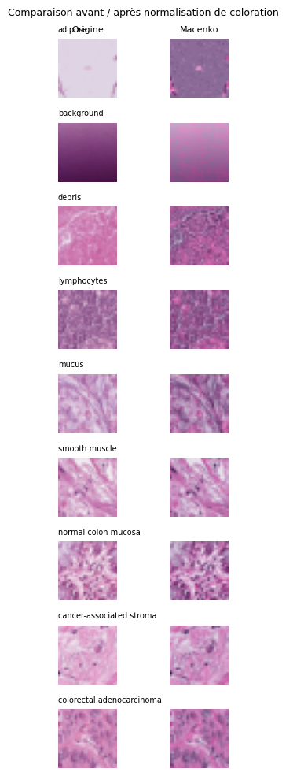
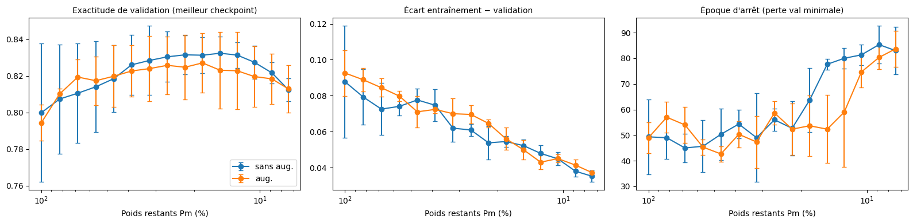
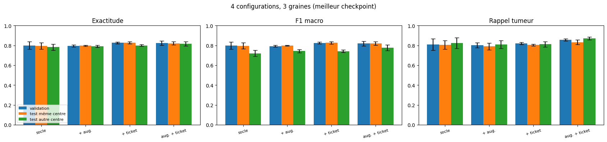
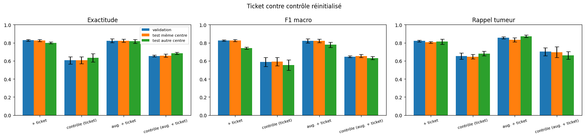
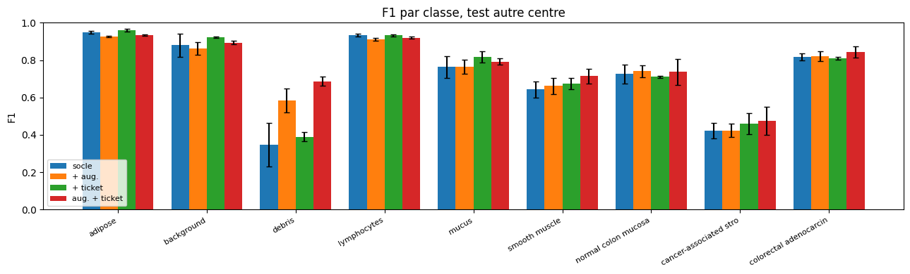
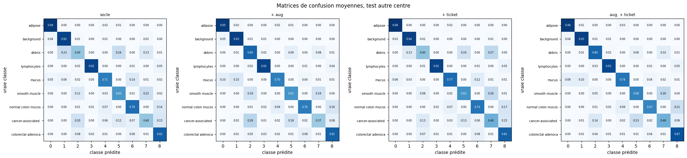
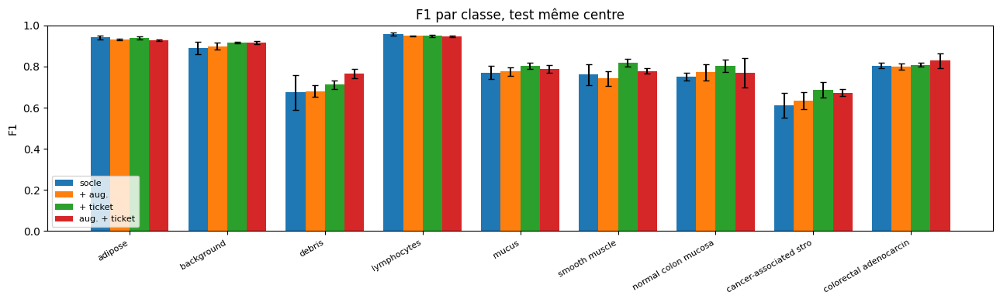
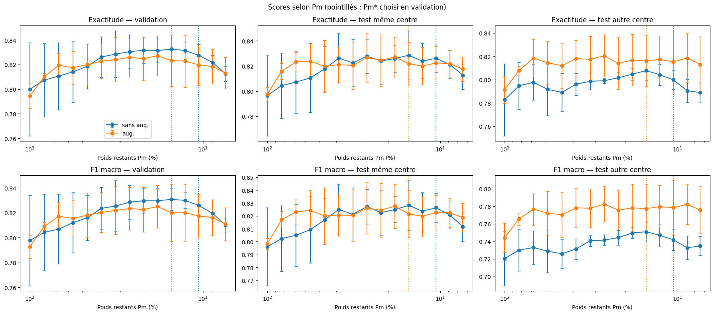

# PathMNIST — Normalisation de coloration Macenko et Lottery Ticket Hypothesis

## Présentation du projet

Ce projet étudie l'effet de la **normalisation de coloration de Macenko** et de l'**élagage neuronal selon la Lottery Ticket Hypothesis** sur une tâche de classification d'images histopathologiques.

L'objectif est double :

- mesurer l'influence de la normalisation de coloration sur les performances d'un CNN ;
- déterminer si un sous-réseau élagué, réinitialisé à ses poids initiaux, peut conserver voire améliorer les performances du réseau dense, et étudier sa capacité à généraliser à un autre centre d'acquisition.

Le protocole compare quatre configurations principales : réseau de base, réseau avec Macenko, ticket gagnant sans Macenko, et ticket gagnant avec Macenko. Les expériences sont répétées avec **trois graines aléatoires**.

---

## 1. Présentation des données

### 1.1 Jeu de données

Les expériences utilisent **PathMNIST**, issu de MedMNIST. Il s'agit d'images histopathologiques de tissus colorectaux, réparties en neuf classes. Les images sont redimensionnées en **28 × 28 pixels**, avec trois canaux RGB.

Les neuf classes sont :

1. Adipose
2. Background
3. Debris
4. Lymphocytes
5. Mucus
6. Smooth muscle
7. Normal colon mucosa
8. Cancer-associated stroma
9. Colorectal adenocarcinoma epithelium

### 1.2 Construction des ensembles

Le protocole utilise un sous-ensemble équilibré de 9 000 images d'entraînement, soit 1 000 images par classe.

| Ensemble | Nombre d'images | Utilisation |
|---|---:|---|
| Train officiel | 89 996 | Source du sous-échantillonnage |
| Train expérimental | 9 000 | Entraînement, 1 000 images par classe |
| Validation | 8 004 | Sélection des checkpoints et des niveaux d'élagage |
| Test même centre | 2 000 | Évaluation sur des images issues du centre associé à la validation |
| Test autre centre | 7 180 | Évaluation de la généralisation à un autre centre |

Le jeu de validation officiel est séparé de façon reproductible : 2 000 images sont mises de côté pour constituer le **test même centre**, et les 8 004 images restantes servent à la validation. Le test officiel constitue le **test autre centre**.

Le sous-échantillonnage du train est stratifié : 1 000 images sont tirées aléatoirement dans chacune des neuf classes, avec une graine fixée (`seed_rng = 42`). Cela permet d'avoir un train expérimental équilibré.

### 1.3 Exemples d'images

La figure ci-dessous présente des exemples des neuf catégories utilisées pour l'entraînement.



### 1.4 Décalage entre centres

Le test « autre centre » permet d'évaluer la robustesse du modèle face à un changement de centre d'acquisition. Les distributions de couleur et de texture peuvent différer entre les centres ; cette différence constitue un enjeu important pour la généralisation en histopathologie.

---

## 2. Normalisation de coloration : méthode de Macenko

### 2.1 Objectif

Les images histopathologiques sont colorées, notamment par l'hématoxyline et l'éosine. Les variations de protocole de coloration, de laboratoire ou de scanner peuvent entraîner des différences visuelles entre images, même lorsque les tissus appartiennent à la même classe.

La méthode de **Macenko** vise à réduire ces variations en ramenant les colorations des images vers une référence commune, sans modifier volontairement leur contenu morphologique.

### 2.2 Principe

La méthode travaille dans l'espace de densité optique (*Optical Density*, OD). Pour un pixel RGB, la transformation utilisée est :

$OD = -\log\left(\frac{I+1}{255}\right)$

où $I$ représente l'intensité du pixel.

Les principales étapes de l'implémentation sont :

1. **Passage en densité optique** : conversion des pixels RGB en valeurs OD.
2. **Sélection des pixels de tissu** : exclusion des pixels dont la norme OD est inférieure au seuil $beta = 0.15$.
3. **Estimation des colorations** : calcul de la matrice de covariance des pixels OD, puis projection sur le plan défini par les deux principaux vecteurs propres.
4. **Estimation des deux directions de coloration** : calcul des angles des pixels projetés et sélection des quantiles $alpha = 1%$ et $99%$.
5. **Estimation des concentrations** : résolution des concentrations associées aux deux colorations.
6. **Normalisation** : mise à l'échelle des concentrations à partir du percentile 99, puis reconstruction de l'image RGB avec la matrice de coloration cible.

### 2.3 Référence et prévention de la fuite de données

La matrice de coloration cible et les concentrations de référence sont estimées à partir d'un échantillon de **500 images du jeu d'entraînement uniquement** (`MACENKO_N_REF = 500`, graine `2026`).

La même référence est ensuite appliquée à :

- l'ensemble d'entraînement de 9 000 images ;
- le jeu de validation ;
- le test même centre ;
- le test autre centre.

La référence n'est jamais ré-estimée à partir de la validation ou des tests. Cette précaution évite d'utiliser indirectement les données d'évaluation pour ajuster le prétraitement.

La branche de référence (`sans aug.`) conserve les images originales. La branche `aug.` correspond aux mêmes 9 000 images d'entraînement, normalisées une seule fois par Macenko : il ne s'agit pas d'ajouter des copies supplémentaires au dataset.

### 2.4 Résultat visuel

Comparaison d'exemples avant et après normalisation de coloration par Macenko :



---

## 3. Méthode du ticket gagnant — Lottery Ticket Hypothesis

### 3.1 Référence scientifique

Cette partie s'appuie sur l'article :

> **Jonathan Frankle and Michael Carbin.**  
> *The Lottery Ticket Hypothesis: Finding Sparse, Trainable Neural Networks.*  
> MIT CSAIL.

La *Lottery Ticket Hypothesis* propose qu'un réseau neuronal dense contient des sous-réseaux (les « tickets gagnants ») qui, lorsqu'ils sont entraînés à partir de leur **initialisation d'origine**, peuvent atteindre une performance comparable ou supérieure à celle du réseau initial, avec beaucoup moins de paramètres.

L'idée centrale n'est donc pas seulement de retirer des poids après entraînement : il faut conserver le masque d'élagage, puis **réinitialiser les poids survivants à leurs valeurs initiales**.

### 3.2 Architecture utilisée

Le modèle étudié est un CNN composé de :

- six couches convolutionnelles réparties en trois blocs ;
- 32, 64 puis 128 canaux dans les blocs successifs ;
- une opération de max-pooling à la fin de chaque bloc ;
- une couche entièrement connectée de 256 neurones ;
- une couche de sortie de neuf neurones.

Les convolutions utilisent des noyaux $3x3$. Les images d'entrée sont au format $3x28x28$.

### 3.3 Entraînement initial

L'entraînement utilise :

- l'optimiseur **Adam** ;
- un taux d'apprentissage `LEARNING_RATE = 0.005` ;
- une fonction de perte de classification ;
- un mécanisme d'**early stopping** fondé sur la perte de validation ;
- la conservation du meilleur checkpoint, c'est-à-dire les poids de l'époque où la perte de validation est minimale.

L'entraînement s'arrête lorsque la perte de validation ne s'améliore plus pendant le nombre d'époques défini par `PATIENCE`, ou lorsque le budget maximal d'époques est atteint.

### 3.4 Élagage itératif et réinitialisation

Un tour d'élagage suit les étapes suivantes :

1. Entraîner le réseau masqué $m \odot theta_0$, où $theta_0$ désigne l'initialisation initiale et $m$ le masque courant.
2. Récupérer le meilleur checkpoint selon la perte de validation.
3. Appliquer un élagage par magnitude : retirer les poids de plus faible valeur absolue, couche par couche.
4. Réinitialiser les poids encore présents à leurs valeurs dans $theta_0$.
5. Recommencer l'entraînement avec le nouveau masque.

L'élagage est non structuré et réalisé couche par couche. À chaque tour, le taux de retrait des poids vivants est de :

- 15 % pour les couches convolutionnelles ;
- 20 % pour `fc1` ;
- 10 % pour `fc2`.

Les poids déjà élagués ne peuvent pas être sélectionnés à nouveau. Le masque est réappliqué après chaque mise à jour de l'optimiseur afin que les poids supprimés ne puissent pas réapparaître.

### 3.5 Contrôle par réinitialisation indépendante

Pour vérifier que les performances du sous-réseau viennent bien de l'initialisation initiale $theta_0$, un contrôle est réalisé :

- on conserve le masque du ticket sélectionné ;
- on entraîne ce même sous-réseau avec une autre initialisation (graine initiale + 1000) ;
- les données et l'ordre des batchs restent identiques.

Si le ticket initialisé avec $theta_0$ obtient de meilleurs résultats que ce contrôle, cela soutient l'hypothèse que l'initialisation d'origine joue un rôle important.

### 3.6 Choix du niveau d'élagage

Le niveau $P_m^*$ est sélectionné séparément pour les deux branches à partir de la validation (graine 0), sans consulter les jeux de test. La règle choisit la meilleure exactitude de validation ; si plusieurs niveaux sont à moins de 0,5 point du meilleur, le niveau le plus élagué est retenu.

Les niveaux retenus dans l'exécution du notebook sont :

| Branche | Tour sélectionné $n^*$ | Poids conservés $P_m^*$ |
|---|---:|---:|
| Images originales | 12 | 10,6 % |
| Macenko | 10 | 15,2 % |

---

## 4. Résultats et généralisation

### 4.1 Évolution de la validation pendant l'élagage

Les trajectoires ci-dessous présentent la moyenne et l'écart-type sur trois graines. La branche sans augmentation utilise les images originales ; la branche `aug.` utilise les images normalisées par Macenko.



Pour la branche sans Macenko, l'exactitude moyenne de validation passe de **80,0 %** avec le réseau dense à un maximum observé de **83,2 %** aux niveaux de 22,0 % et 15,2 % de poids conservés. Elle redescend ensuite lorsque le réseau devient encore plus parcimonieux.

Pour la branche Macenko, l'exactitude moyenne de validation passe de **79,4 %** au réseau dense à un maximum observé de **82,7 %** à 18,3 % de poids conservés. Les performances restent proches autour de 15,2 % et 12,7 % de poids conservés.

Ces résultats montrent qu'un élagage modéré peut améliorer l'exactitude de validation dans cette expérience. En revanche, les niveaux les plus extrêmes finissent par dégrader les performances.

### 4.2 Comparaison des configurations

Les quatre configurations comparées sont :

| Configuration | Description |
|---|---|
| `socle` | CNN dense entraîné sur les images originales |
| `+ aug.` | CNN dense entraîné sur les images normalisées par Macenko |
| `+ ticket` | Sous-réseau sélectionné, réinitialisé à l'initialisation d'origine, sans Macenko |
| `aug. + ticket` | Sous-réseau sélectionné, réinitialisé à l'initialisation d'origine, avec Macenko |

Les indicateurs étudiés sont l'exactitude (*accuracy*), le F1 macro et le rappel de la classe tumorale. Ils sont mesurés sur la validation, le test même centre et le test autre centre.



### 4.3 Ticket gagnant et contrôle

Le contrôle réinitialisé permet de distinguer l'effet du masque d'élagage de celui de l'initialisation initiale.



Les résultats du notebook montrent des exactitudes de validation nettement plus faibles pour les contrôles réinitialisés indépendamment :

| Branche | Ticket : poids conservés | Contrôle : accuracy validation (graines 0, 1, 2) |
|---|---:|---|
| Images originales | 10,6 % | 64,9 % ; 56,9 % ; 60,1 % |
| Macenko | 15,2 % | 66,4 % ; 64,3 % ; 65,5 % |

Cette comparaison est cohérente avec l'idée que le masque seul ne suffit pas : l'initialisation d'origine est importante pour obtenir les performances du ticket.

### 4.4 Généralisation à un autre centre

Le test autre centre est particulièrement important : il permet de mesurer la capacité du modèle à fonctionner sur des images provenant d'un centre différent de celui utilisé pour la validation et le test même centre.





La comparaison des résultats sur le test même centre et sur le test autre centre met en évidence un écart de domaine. La normalisation Macenko vise précisément à réduire les variations de coloration susceptibles de contribuer à cet écart. Les figures doivent toutefois être interprétées classe par classe : une amélioration moyenne ne garantit pas une amélioration uniforme sur les neuf classes.

### 4.5 Résultats par classe et selon la sparsité





Les courbes selon $P_m$ sont descriptives : le niveau $P_m^*$ est choisi sur la validation, et non sur les tests. Les performances de test ne sont donc pas utilisées pour sélectionner le ticket.

### 4.6 Synthèse

Les expériences conduisent aux observations suivantes :

- **Macenko** fournit une normalisation visuelle de la coloration à partir d'une référence estimée exclusivement sur le train.
- **L'élagage modéré** améliore l'exactitude de validation par rapport au réseau dense dans les deux branches.
- Les niveaux sélectionnés conservent une petite fraction des poids : 10,6 % sans Macenko et 15,2 % avec Macenko.
- Le **contrôle réinitialisé** obtient une exactitude de validation nettement plus faible que le ticket, ce qui souligne l'importance de l'initialisation initiale.
- Le test autre centre permet d'évaluer la généralisation sous décalage de domaine. Les métriques par classe et les matrices de confusion sont nécessaires pour ne pas masquer les difficultés de certaines catégories.

Ces conclusions restent propres à ce protocole expérimental, à l'architecture CNN utilisée et aux trois graines testées.

---

## Reproductibilité

### Environnement et bibliothèques

Le notebook utilise notamment :

- Python
- PyTorch
- NumPy
- pandas
- Matplotlib
- MedMNIST
- torchstain (installé dans le notebook ; l'implémentation Macenko décrite ci-dessus est également explicitée dans le code)

### Lancer le projet

1. Cloner le dépôt.
2. Installer les dépendances nécessaires.
3. Ouvrir `Macenko_winning_ticket_project.ipynb` dans Jupyter ou Google Colab.
4. Exécuter les cellules dans l'ordre.

Le jeu PathMNIST est téléchargé via MedMNIST. Les graines, paramètres de normalisation, paramètres d'entraînement et taux d'élagage sont définis dans le notebook.

### Arborescence recommandée

```text
.
├── README.md
├── Macenko_winning_ticket_project.ipynb
└── readme_assets/
    ├── pathmnist_samples.png
    ├── macenko_before_after.png
    ├── pruning_trajectory.png
    ├── loss_curves.png
    ├── metrics_comparison.png
    ├── ticket_vs_control.png
    ├── f1_other_center.png
    ├── f1_same_center.png
    ├── confusion_matrices.png
    └── scores_vs_sparsity.png
```

---

## Référence

Frankle, J., & Carbin, M. **The Lottery Ticket Hypothesis: Finding Sparse, Trainable Neural Networks.** MIT CSAIL.

Le protocole de ticket gagnant présenté ici reprend le principe central de l'article : élaguer un réseau entraîné, puis réinitialiser les poids survivants à leur initialisation d'origine afin de tester si le sous-réseau constitue un ticket gagnant.
